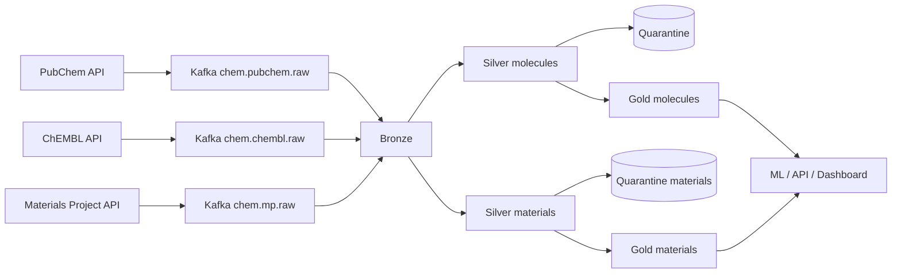

# ChemStream Runbook (data pipeline)

## Start / stop
Start: docker compose up -d --build. Stop: docker compose down.
Jobs (each in its own terminal): spark_jobs.bronze, spark_jobs.silver, spark_jobs.silver_materials.
Batch jobs (run periodically): spark_jobs.gold, spark_jobs.gold_materials, spark_jobs.quality.

## Producers
pubchem_producer <start_cid> <count>, chembl_producer <offset> <count>, mp_producer <skip> <count>.
Watermarks are in ledger/*_watermark.txt. MP_API_KEY must be set in .env.

## Health checks
python -m tools.peek <table>, python -m tools.show_quality. Healthy: all_checks_passed True,
valid_pct above 90, silver_duplicates 0.

## Recovery
- A job crashed: start it again; it resumes from checkpoints/.
- Kafka down: start Kafka, then restart Bronze.
- Wrong data or schema change: stop jobs, delete lake/silver*, lake/quarantine*, checkpoints/silver*,
  restart Silver (rebuilds from Bronze; no API calls needed).
- Full reset: stop jobs, delete lake/, checkpoints/, ledger/, data/.

## Experiments
python -m tools.run_experiment --exp <new-name> --cores N --rate R --seconds S [--fault ...]
Results append to results/results.csv. Delete exp/ afterwards to free disk space.

## Pipeline diagram
